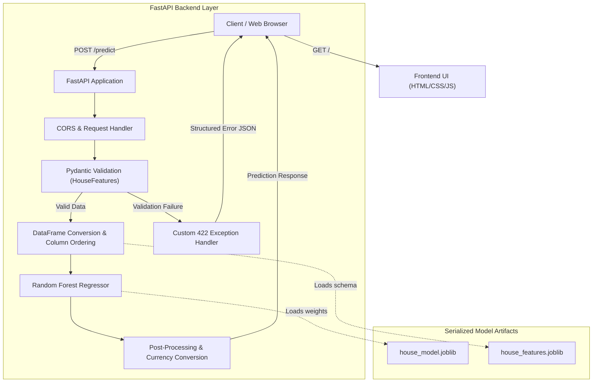

# California Housing Price Prediction System

An end-to-end machine learning system and REST API designed to predict residential property values based on demographic, structural, and geographic attributes using the California Housing dataset.

---

## Architecture



---

## Problem

Manual property valuation in real estate is subjective, slow, and prone to inconsistent appraisals. Housing prices are governed by complex, multi-dimensional interactions across:
- **Demographics**: Local median household income, neighborhood population density.
- **Structural Characteristics**: Average room counts, bedroom ratios, and property age.
- **Geographic Coordinates**: Precise spatial location (latitude and longitude).

Simple linear heuristics fail to account for non-linear price thresholds and regional micro-markets. Organizations need an automated, reproducible, and objective tool for instant valuation estimates.

---

## Task

1. Train an accurate regression model capable of estimating continuous median home values.
2. Package the model into an asynchronous, low-latency REST API using FastAPI.
3. Enforce strict schema validation and range checking to prevent out-of-distribution or corrupted payloads.
4. Provide actionable, human-readable error diagnostics rather than raw stack traces.
5. Create a clean, responsive web interface for non-technical users to run valuations.

---

## Approach

### 1. Data Processing and Feature Engineering
- Utilized the California Housing dataset (20,640 records across 8 numerical features).
- Applied an 80/20 train-test split with a fixed random seed (`random_state=42`) for reproducibility.
- Preserved exact feature column sequencing during preprocessing to guarantee consistent inference mapping.

### 2. Model Selection and Training
- Selected an ensemble `RandomForestRegressor` with 100 estimators (`n_jobs=-1`).
- Captured non-linear regional dynamics and feature cross-dependencies without requiring complex manual feature transformations.
- Serialized the trained pipeline and ordered feature column list using `joblib`.

### 3. API Design and Validation
- Constructed a strongly-typed Pydantic model (`HouseFeatures`) enforcing exact mathematical and geographic limits:
  - `MedInc`: Median income in tens of thousands ($0.5k to $15.0k).
  - `HouseAge`: 1 to 52 years.
  - `AveRooms`: 1.0 to 15.0 rooms.
  - `AveBedrms`: 0.5 to 4.0 bedrooms.
  - `Population`: 100 to 35,000 residents per block group.
  - `AveOccup`: 1.0 to 15.0 average household members.
  - `Latitude`: 32.0 to 42.0 (California bounds).
  - `Longitude`: -125.0 to -114.0 (California bounds).
- Built a custom `RequestValidationError` handler returning structured field-by-field diagnostics when invalid data is supplied.

### 4. User Interface
- Designed a lightweight, zero-dependency frontend using vanilla HTML5, CSS3, and JavaScript.
- Served directly by FastAPI via mounted static assets and file responses.
- Implemented client-side guardrails, region quick-pick presets, live salary calculation helpers, and sample data autofill.

---

## Solution

The completed solution is a production-ready application containing:
- **Inference Engine**: Pre-loaded Random Forest model delivering sub-50ms predictions.
- **RESTful Endpoints**: Predict, health check, sample payload, and documentation endpoints.
- **Valuation Output**: Converts target index values ($100,000s) into formatted currency (`$USD`), categorizes properties into valuation tiers (Affordable, Moderate, High, Luxury), and echoes an input summary.
- **Dual Interface**: Fully accessible via automated HTTP requests or the bundled interactive browser UI.

---

## Project Structure

```text
house_prediction_api/
|-- explore.py               # Dataset inspection and structure exploration
|-- train.py                 # Training script and model serialization
|-- main.py                  # FastAPI application, routing, and prediction logic
|-- requirements.txt         # Production dependencies
|-- house_model.joblib       # Serialized Random Forest model weights
|-- house_features.joblib    # Serialized feature column names
`-- static/
    |-- index.html           # Frontend structure
    |-- styles.css           # Styling and design system
    |-- app.js               # Client validation and API integration
    `-- bg.jpg               # Architectural background image
```

---

## API Endpoints

| Method | Endpoint | Description |
| :--- | :--- | :--- |
| `GET` | `/` | Serves the interactive Web UI |
| `GET` | `/api` | API status and endpoint directory |
| `GET` | `/health` | Model health status and feature schema |
| `GET` | `/predict/example` | Returns a valid sample request payload |
| `POST` | `/predict` | Computes property valuation from input features |
| `GET` | `/docs` | Swagger interactive API documentation |

---

## Sample Request and Response

### Prediction Request (`POST /predict`)

```json
{
  "MedInc": 4.0583,
  "HouseAge": 41.0,
  "AveRooms": 5.818,
  "AveBedrms": 1.038,
  "Population": 1127.0,
  "AveOccup": 2.6,
  "Latitude": 37.88,
  "Longitude": -122.23
}
```

### Successful Response (`200 OK`)

```json
{
  "status": "success",
  "prediction": {
    "estimated_price_usd": "$184,538.00",
    "estimated_price_number": 184538.0,
    "raw_model_value": 1.8454,
    "price_bracket": "Moderate ($150,000 - $300,000)"
  },
  "input_summary": {
    "median_income": "$40,583 / year",
    "house_age": "41 years",
    "average_rooms": 5.818,
    "average_bedrooms": 1.038,
    "block_population": 1127,
    "average_occupancy": "2.6 people/house",
    "location": {
      "latitude": 37.88,
      "longitude": -122.23
    }
  },
  "raw_input": {
    "MedInc": 4.0583,
    "HouseAge": 41.0,
    "AveRooms": 5.818,
    "AveBedrms": 1.038,
    "Population": 1127.0,
    "AveOccup": 2.6,
    "Latitude": 37.88,
    "Longitude": -122.23
  }
}
```

### Validation Error Response (`422 Unprocessable Entity`)

```json
{
  "status": "error",
  "error_type": "Invalid Input Data",
  "message": "One or more input values are missing or out of valid range.",
  "total_errors": 1,
  "error_details": [
    {
      "field": "MedInc",
      "error": "Input should be greater than or equal to 0.5",
      "value_received": 0.1
    }
  ],
  "hint": "Use GET /predict/example to see a valid input format and value ranges."
}
```

---

## Installation and Local Setup

### 1. Clone Repository and Navigate to Folder

```bash
git clone https://github.com/kumarsahup07/California-House-Prediction.git
cd California-House-Prediction
```

### 2. Create and Activate Virtual Environment

```bash
# Windows
python -m venv myenv
.\myenv\Scripts\activate

# Linux / macOS
python3 -m venv myenv
source myenv/bin/activate
```

### 3. Install Dependencies

```bash
pip install -r requirements.txt
```

### 4. (Optional) Re-train Model

```bash
python train.py
```

### 5. Run the Server

```bash
uvicorn main:app --port 8000 --reload
```

Access the application in your browser at `http://127.0.0.1:8000`.

---

## Deployment Configuration

### Render Deployment
- **Runtime**: Python 3
- **Build Command**: `pip install -r requirements.txt`
- **Start Command**: `uvicorn main:app --host 0.0.0.0 --port $PORT`
- **Large Files**: Model files over 100 MB are tracked using `git-lfs`.
